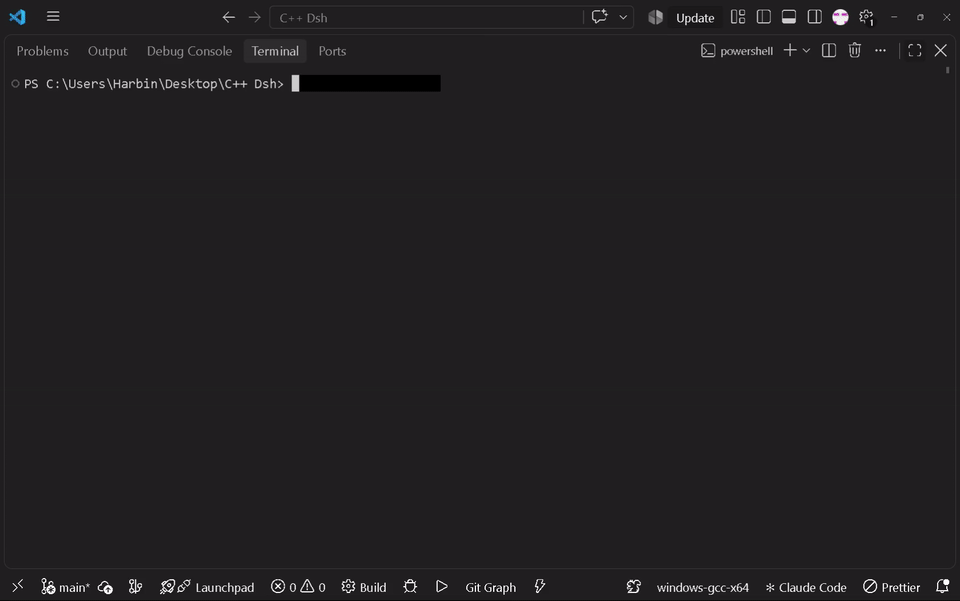
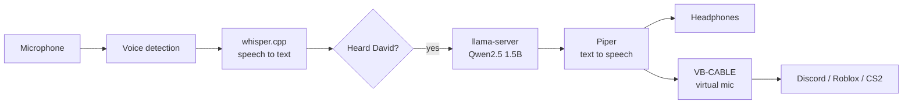

# DAVID: a local AI voice assistant in C++



## Introduction

DAVID is a Jarvis-style voice assistant that runs **entirely on your own computer**. There is no cloud, no account and no API key. You say **"Hey David"**, ask a question, and he answers out loud in a natural voice.

He is also built for gaming and voice chat. His voice plays in your headphones **and** into a virtual microphone, so friends in Discord, Roblox or CS2 can hear him too.

DAVID is designed for **mid-range and low-end PCs and laptops**. He runs on the CPU alone and uses small AI models, so you don't need a graphics card. The trade-off is speed: replies take roughly **2 to 5 seconds** depending on your CPU and how long the answer is. Faster CPUs answer sooner, and older ones take a little longer.

## The AI behind DAVID

Everything runs locally. These are the three models DAVID uses:

| Job | Model | Runs with | Size |
|---|---|---|---|
| Understands what you say (speech to text) | [Whisper](https://github.com/openai/whisper) `base.en` | [whisper.cpp](https://github.com/ggml-org/whisper.cpp) | about 150 MB |
| Thinks and answers (the brain) | [Qwen2.5 1.5B Instruct](https://huggingface.co/Qwen/Qwen2.5-1.5B-Instruct-GGUF), 4-bit | [llama.cpp](https://github.com/ggml-org/llama.cpp) `llama-server` | about 1 GB |
| Speaks the answer (text to speech) | [Piper](https://github.com/rhasspy/piper) voice `en_US-lessac-medium` | Piper | about 60 MB |

DAVID's personality is a system prompt in `src/main.cpp` (`SYSTEM_PROMPT`). He is told to take a side and give opinions instead of replying "I'm just an AI". You can edit that text to make him sarcastic, formal, or anything else.

## How it works



1. The microphone is always listening. A simple volume check finds when you start and stop talking.
2. Whisper turns that audio into text.
3. If the text contains "David", the rest is your question.
4. The question goes to the local Qwen model through llama-server's API.
5. Piper turns the answer into speech, which plays on your headphones and on the virtual microphone.
6. The mic is muted while DAVID talks, so he never hears himself.

| File | Purpose |
|---|---|
| `src/main.cpp` | Mic capture, voice detection, wake word, calls to Whisper, Piper and llama-server |
| `src/dualplay.h` | Plays audio to the default output and to VB-CABLE at the same time |

## What you need

**Computer**
- Windows 10 or 11 (64-bit)
- A CPU with AVX2 support (most Intel and AMD chips from about 2015 onward). **No graphics card is needed.**
- At least 4 GB of free RAM (8 GB or more total is more comfortable)
- About 2 GB of free disk space for the models. They can live on a slow hard drive, because they are read once at startup.
- A microphone, and headphones if you want to broadcast (so the mic doesn't pick up DAVID from speakers)

**Software**
- [MSYS2](https://www.msys2.org/) with the UCRT64 `g++` compiler (C++17)
- [Git](https://git-scm.com/) to clone the repo
- [VB-CABLE](https://vb-audio.com/Cable/) (free) **only if** you want DAVID's voice to work as a microphone in other apps
- Internet, only for downloading the models and tools once. DAVID itself works offline.

**Tested on:** Intel Core i5-9500 (6 cores), CPU only, Windows 10/11.

## What I used to build it

- **C++17**, compiled with `g++` from MSYS2, edited in **Visual Studio Code**
- **llama.cpp** to run the language model locally and expose an HTTP API
- **whisper.cpp** for offline speech recognition
- **Piper** for offline text to speech
- **miniaudio** for microphone capture and audio output to specific devices
- **cpp-httplib** and **nlohmann/json** to talk to llama-server
- **VB-CABLE** as the virtual microphone, plus Windows' "Listen to this device" to mix the real mic into it
- Developed with help of friends in LLM/LSM field, ofc with AI too,and the rest with the skill we had

## Setup

The code currently expects everything under `D:\DAVID`. To use another drive or folder, replace `D:\\DAVID` in `src/main.cpp` (it is written with double backslashes). A config file is on the roadmap.

### 1. Get the code and the headers

```powershell
git clone https://github.com/biniikamberi/David-AI-VA.git
cd David-AI-VA
mkdir third_party
curl.exe -L -o third_party\httplib.h "https://raw.githubusercontent.com/yhirose/cpp-httplib/master/httplib.h"
curl.exe -L -o third_party\json.hpp "https://github.com/nlohmann/json/releases/download/v3.11.3/json.hpp"
curl.exe -L -o third_party\miniaudio.h "https://raw.githubusercontent.com/mackron/miniaudio/master/miniaudio.h"
```

### 2. Download the AI pieces

```powershell
mkdir D:\DAVID\models, D:\DAVID\voices

# Brain: Qwen2.5 1.5B (about 1 GB)
curl.exe -L -o D:\DAVID\models\qwen2.5-1.5b-instruct-q4_k_m.gguf "https://huggingface.co/Qwen/Qwen2.5-1.5B-Instruct-GGUF/resolve/main/qwen2.5-1.5b-instruct-q4_k_m.gguf"

# Voice: Piper
curl.exe -L -o D:\DAVID\piper.zip "https://github.com/rhasspy/piper/releases/download/2023.11.14-2/piper_windows_amd64.zip"
Expand-Archive D:\DAVID\piper.zip -DestinationPath D:\DAVID -Force
curl.exe -L -o D:\DAVID\voices\en_US-lessac-medium.onnx "https://huggingface.co/rhasspy/piper-voices/resolve/main/en/en_US/lessac/medium/en_US-lessac-medium.onnx"
curl.exe -L -o D:\DAVID\voices\en_US-lessac-medium.onnx.json "https://huggingface.co/rhasspy/piper-voices/resolve/main/en/en_US/lessac/medium/en_US-lessac-medium.onnx.json"

# Ears: whisper.cpp (v1.8.4 Windows build) and the base.en model
curl.exe -L -o D:\DAVID\whisper.zip "https://github.com/ggml-org/whisper.cpp/releases/download/v1.8.4/whisper-bin-x64.zip"
Expand-Archive D:\DAVID\whisper.zip -DestinationPath D:\DAVID\whisper_tmp -Force
$dir = (Get-ChildItem D:\DAVID\whisper_tmp -Recurse -Filter whisper-cli.exe | Select-Object -First 1).DirectoryName
mkdir D:\DAVID\whisper -Force | Out-Null
Copy-Item "$dir\*" D:\DAVID\whisper -Recurse -Force
Remove-Item D:\DAVID\whisper_tmp -Recurse -Force
curl.exe -L -o D:\DAVID\whisper\ggml-base.en.bin "https://huggingface.co/ggerganov/whisper.cpp/resolve/main/ggml-base.en.bin"
```

Your folder should end up like this:

```
D:\DAVID\
├── models\qwen2.5-1.5b-instruct-q4_k_m.gguf
├── piper\piper.exe
├── voices\en_US-lessac-medium.onnx (and .onnx.json)
└── whisper\whisper-cli.exe, ggml-base.en.bin
```

### 3. Get llama-server

Download the Windows CPU build from the [llama.cpp releases page](https://github.com/ggml-org/llama.cpp/releases) and unzip it anywhere. You only need `llama-server.exe` and the DLLs next to it.

### 4. Build DAVID

```powershell
g++ -std=c++17 -O2 -D_WIN32_WINNT=0x0A00 -I third_party src\main.cpp -o david.exe -lws2_32 -lwinmm
```

## Run it

You need two terminals.

**Terminal 1: the brain.** Wait for the "listening on http://127.0.0.1:8080" line, then leave it open.

```powershell
.\llama-server.exe -m "D:\DAVID\models\qwen2.5-1.5b-instruct-q4_k_m.gguf" --port 8080 -c 2048 -t 4
```

**Terminal 2: DAVID.** Stay quiet for the 2-second noise calibration, then say "Hey David" and ask something.

```powershell
.\david.exe
```

If he reacts to background noise or misses your voice, pass your own speech threshold, for example `.\david.exe 400` (lower is more sensitive). Press `Ctrl+C` to quit.

## Making DAVID faster or smarter

Speed and intelligence trade off against each other. The default Qwen 1.5B model is a balance for mid-range CPUs. Because the brain runs in `llama-server`, switching models only changes the file in the Terminal 1 command.

| Goal | What to change |
|---|---|
| Faster on a weak CPU or laptop | Use the smaller [Qwen2.5 0.5B](https://huggingface.co/Qwen/Qwen2.5-0.5B-Instruct-GGUF) model. It answers sooner but is less accurate. |
| Smarter answers | Use [Qwen2.5 3B](https://huggingface.co/Qwen/Qwen2.5-3B-Instruct-GGUF). It needs about 2 GB more RAM and is slower. |
| Better speech recognition | Swap in `ggml-small.en.bin` (and change the name in `src/main.cpp`). It hears you more accurately but adds a few seconds. |
| Shorter waits | Lower `-t` if your PC lags while DAVID thinks, or raise it if you have spare cores. Shorter answers also speak sooner. |

## Use DAVID as a microphone in Discord, Roblox or CS2

1. Install the free [VB-CABLE](https://vb-audio.com/Cable/) driver (run its setup as administrator, then restart).
2. Keep your real microphone as the **default recording device** in Windows. DAVID listens with it.
3. Open `mmsys.cpl`, go to the **Recording** tab, open your real mic's **Properties > Listen**, tick **Listen to this device**, and choose **CABLE Input** as the playback device. This sends your voice into the cable.
4. Leave **Listen to this device** unticked on **CABLE Output**.
5. In Discord or the game, set the microphone to **CABLE Output**. Friends now hear you and DAVID.
6. Use headphones, so your real mic doesn't pick up DAVID's voice from speakers.

When you are not using DAVID, set the app's microphone back to your real mic. Your mic quality is unaffected when an app uses it directly.

## Troubleshooting

| Problem | Fix |
|---|---|
| "Can't reach llama-server" | Start Terminal 1 and wait for the "listening" line first |
| DAVID never reacts to your voice | Lower the threshold (`.\david.exe 100`) and check the default recording device |
| He reacts to noise or typing | Raise the threshold (`.\david.exe 500`) |
| `[VB-CABLE not found: speakers only]` | Install VB-CABLE and restart Windows |
| Compile error `httplib doesn't support Windows 8` | Keep `-D_WIN32_WINNT=0x0A00` in the build command |
| Wrong words in the `[heard]` lines | Try the larger `ggml-small.en.bin` Whisper model |
| Can't hear anything after installing VB-CABLE | Set your headphones as the default playback device in `mmsys.cpl` |

## Known limitations

- Replies take about 2 to 5 seconds on mid-range CPUs, because Whisper and Piper start fresh for every phrase.
- Windows only for now.
- The wake word works by transcribing speech and looking for "david", not with a dedicated wake-word engine.
- DAVID cannot be interrupted while he is speaking.
- A 1.5B model is fast but makes factual mistakes. Treat its opinions as a sounding board, not as expert advice.

## Roadmap

- [ ] Config file instead of hardcoded `D:\DAVID` paths
- [ ] One-command setup script
- [ ] Faster replies by keeping Whisper and Piper loaded in the background
- [ ] Built-in soundboard with hotkeys
- [ ] PC commands (open apps, CPU and RAM stats, file search) with confirmation
- [ ] Desktop interface with a waveform and chat history

## Credits and licenses

DAVID's own code is released under the [MIT License](LICENSE). It builds on other projects, each with its own license: llama.cpp, whisper.cpp, Piper and its voices, Qwen, miniaudio, cpp-httplib and nlohmann/json. VB-CABLE is donationware from VB-Audio and is not included in this repository. Check each project's page before redistributing anything.
